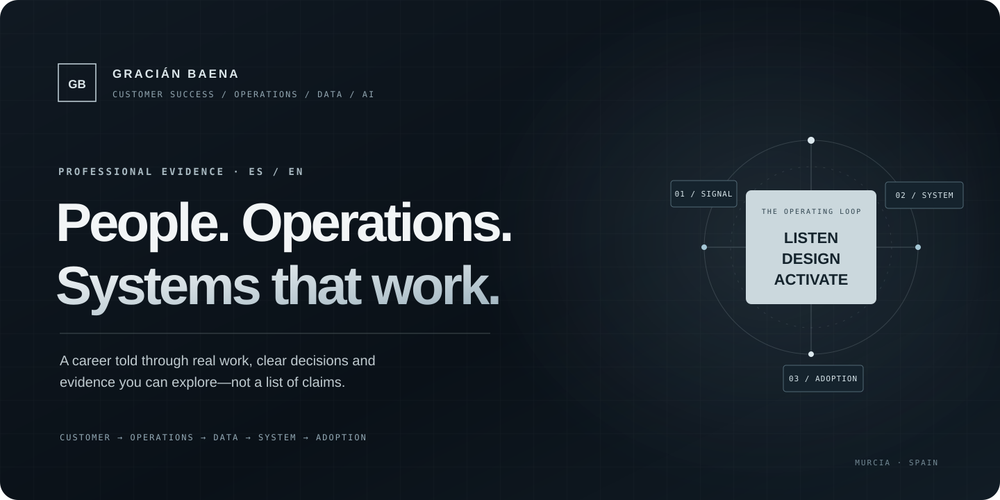

<div align="center">

<a href="https://gracianb.github.io/professional-deck/">
  
</a>

### CUSTOMER SUCCESS · CUSTOMER OPERATIONS · DATA · AI

**A professional story told through real work, clear decisions, and evidence you can explore.**

[**Explore the live portfolio ↗**](https://gracianb.github.io/professional-deck/) &nbsp;·&nbsp;
[**Open the Bodytone case ↗**](https://gracianb.github.io/professional-deck/proyecto-bodytone.html) &nbsp;·&nbsp;
[**View the application desk ↗**](https://gracianb.github.io/GracianB/apply.html?track=professional)

[**LinkedIn**](https://www.linkedin.com/in/gracianbaena/) &nbsp;·&nbsp;
[**Personal hub**](https://gracianb.github.io/GracianB/) &nbsp;·&nbsp;
[**Systems Lab**](https://gracianb.github.io/systems-lab/)

</div>

---

## The work behind the profile

I work at the intersection of **customer experience, operations, data, and technology**. My background spans 16+ years across customer-facing work, teams, and operations; more recently, I have built practical tools and workflows with platforms including Zendesk, Power BI, Python, JavaScript, and automation.

The through-line is simple:

<div align="center">

**CUSTOMER → OPERATIONS → DATA → SYSTEM → ADOPTION → OUTCOME**

</div>

This portfolio is the evidence layer of my professional profile. It is designed to help a reader understand **what I have worked on, how I approach problems, and where public examples can be inspected**—without confusing prototypes with production systems or demos with measured results.

## Start with a case

<table>
  <tr>
    <td width="58%" valign="top">
      <strong>01 / CUSTOMER OPERATIONS</strong><br><br>
      <a href="https://gracianb.github.io/professional-deck/proyecto-bodytone.html"><strong>Bodytone Support OS ↗</strong></a><br>
      A public case study about support operations, Zendesk workflows, knowledge, automation, reporting, and team adoption.
      <br><br>
      <a href="https://bodytonehelp.zendesk.com/hc/es">Open the public Help Center ↗</a>
    </td>
    <td width="42%" valign="top">
      <strong>02 / DECISION SYSTEMS</strong><br><br>
      <a href="https://gracianb.github.io/revops-studio/demo.html"><strong>RevOps Studio demo ↗</strong></a><br>
      Explore a decision workflow using sample data. It is a public demonstration—not a live customer system.
    </td>
  </tr>
  <tr>
    <td width="58%" valign="top">
      <strong>03 / ENGINEERING & INTERACTION</strong><br><br>
      <a href="https://gracianb.github.io/project-ohana/"><strong>Project OHANA ↗</strong></a> ·
      <a href="https://github.com/GracianB/project-ohana">source ↗</a><br>
      A browser game and systems project involving simulation, state, behaviour, regression, and browser testing.
    </td>
    <td width="42%" valign="top">
      <strong>04 / CREATIVE TECHNOLOGY</strong><br><br>
      <a href="https://vortex-gilt-xi.vercel.app/"><strong>VØRTICE ↗</strong></a> ·
      <a href="https://github.com/GracianB/vortex">source ↗</a><br>
      An interactive WebGL audiovisual experience. Availability of the live experience is maintained separately from this repository.
    </td>
  </tr>
</table>

**More to explore:** [Systems Lab ↗](https://gracianb.github.io/systems-lab/) brings together technical experiments, public showcases, and projects with clearly stated access boundaries. Aigoritmo is a local/private application; its public page is a showcase, not a public chat service.

## A portfolio built for two reading speeds

The live deck offers a **quick overview** as well as a more detailed route through the work. Start with the key case, jump to career experience, or explore the demonstrations directly.

- **Evidence first:** public cases and interactive examples are easy to reach.
- **A clear operating model:** customer context, operational friction, data, decisions, systems, and adoption are connected in one narrative.
- **Career context:** six expandable experience chapters provide a deeper view without making the first read feel like an endless CV.
- **60-second recruiter brief:** a concise, optional overview with links to the relevant evidence.
- **Interactive navigation:** presentation mode, keyboard navigation, and a searchable command palette.
- **Bilingual experience:** English and Spanish, with dark and light themes.
- **Responsive and accessible by design:** mobile layouts, visible focus, and reduced-motion support are part of the project’s quality checks.

[**Open the full interactive deck ↗**](https://gracianb.github.io/professional-deck/)

## What the public examples show

| Example | Explore | Scope and status |
| --- | --- | --- |
| **Bodytone Support OS** | [Case study](https://gracianb.github.io/professional-deck/proyecto-bodytone.html) · [Help Center](https://bodytonehelp.zendesk.com/hc/es) | Publicly accessible case and Help Center. No private customer data or internal credentials are published here. |
| **RevOps Studio** | [Sample-data demo](https://gracianb.github.io/revops-studio/demo.html) | Demonstration with sample data; not a production customer system. |
| **Project OHANA** | [Play](https://gracianb.github.io/project-ohana/) · [Source](https://github.com/GracianB/project-ohana) | Public browser experience and source repository. |
| **VØRTICE** | [Experience](https://vortex-gilt-xi.vercel.app/) · [Source](https://github.com/GracianB/vortex) | Public creative-technology project; its deployment is managed separately. |
| **Systems Lab** | [Explore](https://gracianb.github.io/systems-lab/) | Public technical showcase. Some work shown there remains private or local. |

Additional case pages: [Calculator](./proyecto-calculadora.html), [LinkedIn Finder](./proyecto-linkedin.html), and [Outreach GenAI](./proyecto-outreach.html). Availability and scope belong to each linked project; a listing here is not a claim that every tool is a public or production service.

## Explore the experience

The deck is a static, bilingual web portfolio published on GitHub Pages. It uses HTML, CSS, and JavaScript, with interactive slide navigation, a geographic context atlas, expandable career details, and optional recruiter and presentation modes.

**Languages:** Spanish · English · Italian

**Selected tools and platforms:** Zendesk · Power BI · Python · JavaScript · APIs · Google Apps Script · automation · applied AI

[**Open the live experience ↗**](https://gracianb.github.io/professional-deck/) &nbsp;·&nbsp;
[**Explore the Bodytone case ↗**](https://gracianb.github.io/professional-deck/proyecto-bodytone.html)

## Résumés and application documents

The canonical public application documents live in the [GracianB hub repository](https://github.com/GracianB/GracianB). Use those current files rather than older PDFs retained here for historical compatibility.

| Document | English | Español |
| --- | --- | --- |
| **Professional résumé** | [Open PDF ↗](https://gracianb.github.io/GracianB/Gracian_Baena_CV_2026_EN.pdf) | [Abrir PDF ↗](https://gracianb.github.io/GracianB/Gracian_Baena_CV_2026_ES.pdf) |
| **Cover letter** | [Open PDF ↗](https://gracianb.github.io/GracianB/Gracian_Baena_Cover_Letter_EN.pdf) | [Abrir PDF ↗](https://gracianb.github.io/GracianB/Gracian_Baena_Carta_Presentacion_ES.pdf) |

[**Choose a language and application focus ↗**](https://gracianb.github.io/GracianB/apply.html?track=professional)

## Project quality

This repository includes checks for source structure, local assets, CSS rules, browser behaviour, responsive layouts, and production routes. To run the core validation locally:

```bash
npm ci
npm run validate
npm run verify
```

The full `npm run quality` gate also includes browser and cross-browser checks, CSS audits, performance checks, and production smoke tests. It requires the project’s supported Node.js version and installed browser tooling; see [`package.json`](./package.json) for the current scripts.

A passing repository check validates the checks that ran for that revision. It does not independently prove availability of third-party demos or measure business outcomes.

## Repository map

| Path | Purpose |
| --- | --- |
| `index.html` | Interactive bilingual portfolio deck |
| `i18n.js`, `main.js`, `focus-mode.js` | Language content, navigation, and focus interactions |
| `styles.css`, `v*-*.css`, `p43-signal-engine.css` | Visual system and responsive presentation layers |
| `proyecto-*.html`, `case-*.js`, `case-*.css` | Focused project case pages |
| `assets/` | Portfolio artwork and visual resources |
| `tests/`, `tools/`, `validate.mjs`, `verify.mjs` | Validation and quality tooling |
| `RELEASE_V16.md` | Historical release and evidence-boundary reference |

## Connect

[**LinkedIn**](https://www.linkedin.com/in/gracianbaena/) &nbsp;·&nbsp;
[**Email**](mailto:gracianbaenagonzalez@gmail.com) &nbsp;·&nbsp;
[**Book a conversation**](https://calendar.app.google/n99psBFktwYyoAWi9)

---

<div align="center">

**Professional Deck** · Professional evidence, in context.

[Portfolio](https://gracianb.github.io/professional-deck/) · [Personal hub](https://gracianb.github.io/GracianB/) · [Systems Lab](https://gracianb.github.io/systems-lab/)

</div>
