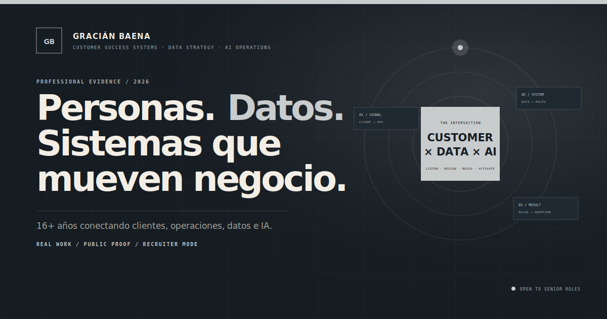

  

<h1 align="center">Gracián Baena · Professional Deck</h1>

<h3 align="center">Customer Success · Customer Operations · Data · Applied AI</h3>

<strong>I turn operational friction into systems people can understand, adopt and use.</strong>

<em>Murcia, Spain · Remote &amp; international collaboration · Spanish / English / Italian</em>

<a href="https://gracianb.github.io/professional-deck/"><strong>Explore the portfolio</strong></a> &nbsp;·&nbsp; <a href="https://gracianb.github.io/professional-deck/proyecto-bodytone.html"><strong>See a real case</strong></a> &nbsp;·&nbsp; <a href="https://gracianb.github.io/GracianB/apply.html?track=professional&amp;focus=customer-success"><strong>Resume &amp; applications</strong></a>

---

## The work behind the portfolio

Customer Success is not simply answering questions. It is understanding why customers get stuck, what teams need to respond, where information breaks down and how to turn those insights into better operations.

My experience spans **16+ years in customer-facing roles, leadership and operations**, including international SaaS and cross-functional work. The connecting thread is the same: **people → processes → trustworthy information → useful systems → adoption**.

I work at the intersection of relationship management and the machinery that supports it: onboarding, enablement, customer knowledge, workflows, pricing context, quality, reporting and collaboration with product and technical teams.

## Three ways to explore my work

| 01 · Understand the customer | 02 · Design the operation | 03 · Make it work |
| --- | --- | --- |
| Listen, investigate, map needs and remove friction. | Connect customer journeys, team workflows, evidence and decisions. | Build, document, test, teach and improve tools that fit real use. |
| **Customer Success** | **Customer Operations / RevOps** | **Data, automation and applied AI** |

The [interactive portfolio](https://gracianb.github.io/professional-deck/) is organized as a narrative you can explore: an operating model, an inspectable case, product experiments, international experience and a direct conversation.

### A real operational case

**[Bodytone Support OS · Explore the case](https://gracianb.github.io/professional-deck/proyecto-bodytone.html)**

An evidence-led look at support operations around Zendesk, service knowledge, routing, enablement and operational visibility. The [public Help Center](https://bodytonehelp.zendesk.com/hc/es) is a live artifact of this context. It is not a disclosure of internal customer records or a claim of independently audited business metrics.

### Decision systems and applied experiments

**[RevOps Studio · Try the sample-data demo](https://gracianb.github.io/revops-studio/demo.html)**

An interactive demonstration of data quality, structured decisions, rules and explainable workflows. **It uses fictional/sample data; it is not a live customer CRM or an autonomous business approval system.**

**[Systems Lab · Explore the wider technical universe](https://gracianb.github.io/systems-lab/)**

My experimental world of interfaces, automation and applied AI, including showcases of local/private applications that are clearly distinguished from public services.

## From experience to evidence

My background connects customer-facing service, SaaS relationships, internal operations, training and international collaboration. Rather than attaching invented percentages to that work, this portfolio shows concrete context and lets you inspect public artifacts.

| Focus | What you can investigate |
| --- | --- |
| **Customer success** | Customer context, onboarding/enablement, service quality and communication |
| **Operational design** | Support workflows, knowledge architecture, ownership and cross-team coordination |
| **Data & automation** | Structured information, reporting, reproducible decisions and appropriate tooling |
| **Systems thinking** | Accessible interfaces, verification, iteration and honest product boundaries |

The timeline and the city atlas provide context from my professional journey. They are not presented as a map of employment dates or an invented performance dashboard.

## A second universe of building

The professional portfolio connects to independent work you can open yourself:

[**Project OHANA**](https://gracianb.github.io/project-ohana/) · Browser game and systems experimentation  
[**VØRTICE**](https://vortex-gilt-xi.vercel.app/) · Interactive WebGL visual instrument  
[**Systems Lab**](https://gracianb.github.io/systems-lab/) · Software, AI and creative engineering

These projects demonstrate how I explore design and implementation. They are **not** represented as previous employer products.

## Resume and application materials

The current public files are maintained in my **[personal hub](https://github.com/GracianB/GracianB)**, the canonical source for professional application documents.

| | English | Español |
| --- | --- | --- |
| **Resume** | [Read CV](https://gracianb.github.io/GracianB/Gracian_Baena_CV_2026_EN.pdf) | [Ver CV](https://gracianb.github.io/GracianB/Gracian_Baena_CV_2026_ES.pdf) |
| **Cover letter** | [Read letter](https://gracianb.github.io/GracianB/Gracian_Baena_Cover_Letter_EN.pdf) | [Ver carta](https://gracianb.github.io/GracianB/Gracian_Baena_Carta_Presentacion_ES.pdf) |

[**Choose a role-specific application and supporting evidence**](https://gracianb.github.io/GracianB/apply.html?track=professional&focus=customer-success)

---

### Let's connect

I am interested in meaningful challenges involving **Customer Success, Customer Operations, process design, data and applied technology**, especially where the problem spans people and systems.

[**LinkedIn**](https://www.linkedin.com/in/gracianbaena/) · [**Email**](mailto:gracianbaenagonzalez@gmail.com) · [**Book a conversation**](https://calendar.app.google/n99psBFktwYyoAWi9)

<strong>People first. Evidence over hype. Systems worth using.</strong>

<a href="https://gracianb.github.io/GracianB/"><strong>The personal hub</strong></a> &nbsp;·&nbsp; <a href="https://gracianb.github.io/yoga-instructor/"><strong>Yoga Instructor</strong></a> &nbsp;·&nbsp; <a href="https://gracianb.github.io/systems-lab/"><strong>Systems Lab</strong></a>

